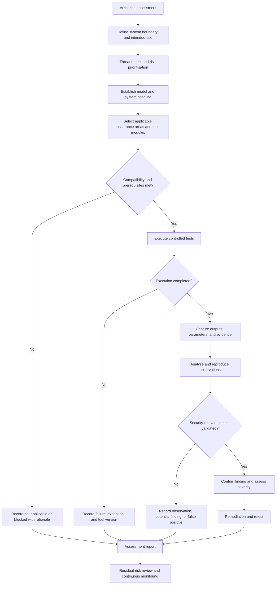

# Assessment flow

This diagram shows how the framework's lifecycle, testing modules, and evidence process connect. It is a reference workflow, not an automated pipeline.

## Interpretation

- A test can be **not applicable** without being a failure.
- A failed test provides no successful test result.
- An executed test may produce a negative result or an observation; neither automatically constitutes a vulnerability.
- A confirmed finding requires reproducible evidence of security-relevant impact within the documented threat model.
- Remediation should be followed by retesting and residual-risk review.
